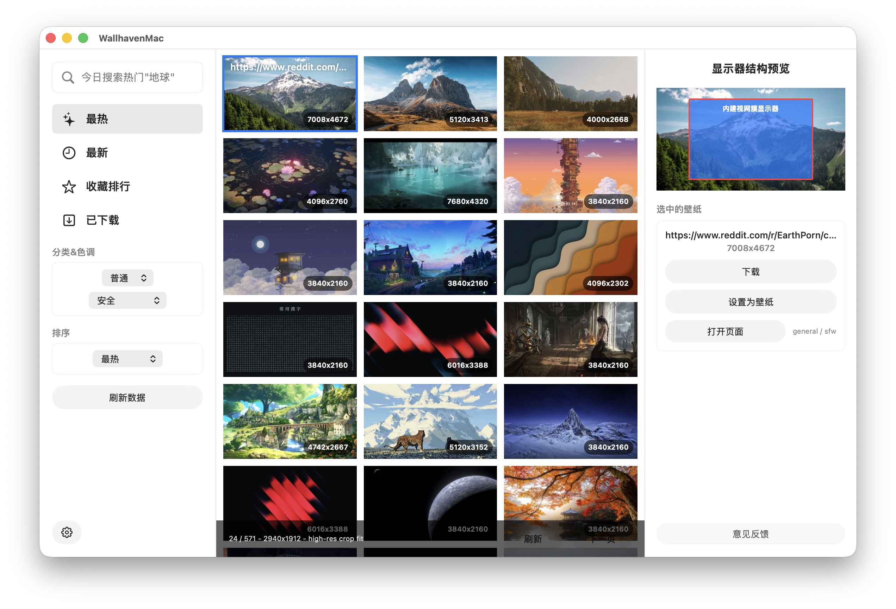

# Wallhaven

浏览、挑选、下载，把喜欢的图片设为桌面壁纸。

Wallhaven 是基于 [wallhaven.cc](https://wallhaven.cc) 的非官方桌面客户端，分别为 macOS、Windows 和 Linux / KDE Plasma 提供平台实现。



*macOS 0.2.0 实际运行截图。各平台使用各自的界面与桌面集成方式。*

## 功能

- 按关键词、分类、内容分级和排序方式查找壁纸。
- 根据显示器分辨率筛选图片，可选择严格匹配宽高比。
- 浏览缩略图、预览选中图片，并打开 Wallhaven 来源页面。
- 下载原图，管理本地下载库，再次应用已下载的壁纸。
- 在应用内设置桌面壁纸，切换中文或英文界面。
- 通过系统凭据服务保存可选的 Wallhaven API Key。

“收藏排行”按 Wallhaven 的收藏数量排序，不是个人收藏夹同步。各平台的具体行为见对应分支说明。

## 选择平台

`main` 是项目首页，只包含介绍和展示素材。源代码、构建与打包脚本保存在平台分支中。

| 平台 | 分支 | 技术栈 | 构建说明 |
| --- | --- | --- | --- |
| macOS 14+ | `mac` | SwiftUI / AppKit | 分支根目录的 `README.md` |
| Windows 10 1809+ / 11，x64 | `codex/windows-port` | Qt 6 / QML / Windows API | `Windows/README.md` |
| Linux / KDE Plasma | `feat/kubuntu-plasma-bluecurve` | Qt 6 / QML / KDE Frameworks 6 | `Linux/README.md` |
| Haiku | `feat/haiku-native-port` | C++ / Haiku 原生界面 | `Haiku/README.md` |

在仓库页面的分支选择器中切换到相应分支，即可阅读该平台的 README。Linux 版本以 Kubuntu 26.04 LTS、KDE Plasma 和 Wayland 为目标环境。

## 获取代码

从仓库页面的 **Code** 菜单复制克隆地址，用它替换下面的 `<REPOSITORY_URL>`。以 macOS 为例：

```sh
git clone --branch mac <REPOSITORY_URL> wallhaven
cd wallhaven
```

其他平台将 `mac` 替换为上表中的分支名称。已克隆完整仓库时，也可以切换平台：

```sh
git fetch origin
git switch mac
```

然后按相应平台的 README 安装依赖、构建和运行。

## 使用方式

1. 从“最热”“最新”“收藏排行”进入图库，或输入关键词搜索。
2. 选择分类、内容分级和排序方式，查看适合显示器的图片。
3. 选中图片进行预览，再下载或设为桌面壁纸。
4. 在“已下载”中查看本地图片、打开下载目录或重新设置壁纸。

普通 SFW 搜索无需填写 API Key。需要使用受限内容筛选时，在应用设置中填写自己的 Wallhaven API Key。密钥分别保存在 macOS 钥匙串、Windows 凭据管理器和 KDE Wallet 中。

## 开发与反馈

各平台独立维护；提交修改前，请先切换到目标分支。部分平台分支仍保留其他平台的历史目录，开发入口以表格为准。

反馈问题时，请附上平台、系统版本、应用版本或提交号，以及复现步骤；界面问题可以附截图。请勿附上 API Key。

## 许可证

源代码与项目文档采用 [MIT 许可证](LICENSE)。

壁纸内容来自 Wallhaven，图片权利归各自权利人所有。本项目不隶属于 wallhaven.cc，也不代表其官方客户端。 MIT 许可证不授予这些壁纸图片的使用权。
